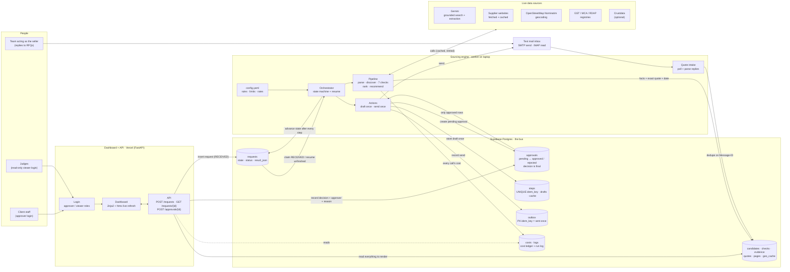
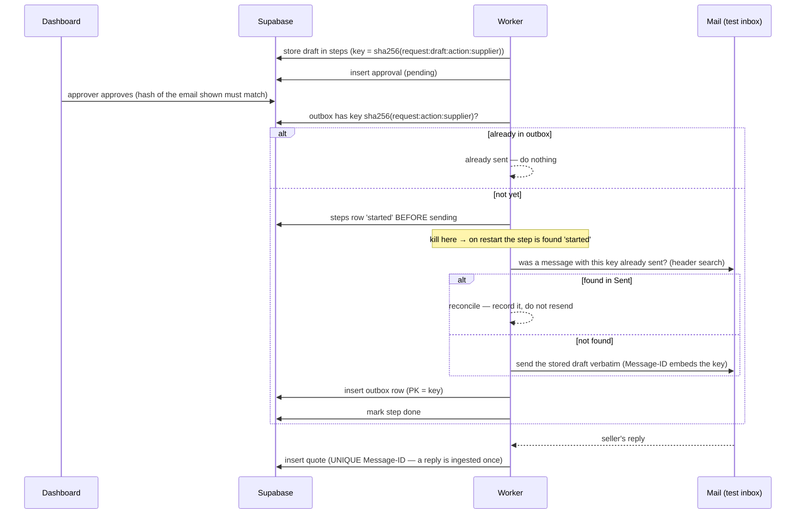
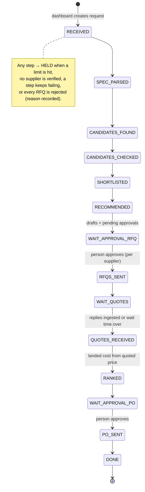

# BoxSource — Architecture

BoxSource does a sourcing agent's whole job for a 3PL client: from a request for packaging
("50,000 five-ply corrugated boxes a month for Gurgaon") to verified manufacturers, quote
requests sent after approval, real quotes compared, and a purchase order sent after approval —
with a source for every fact.

Two processes share one database and never call each other:

- **Dashboard + API** (FastAPI on Vercel, `app.py`, `dashboard/`) — a person submits requests,
  watches the run, reads the evidence and **approves or rejects** each irreversible action.
- **Sourcing engine** (a worker on a laptop, `engine/`, `cli.py`) — runs the state machine, calls
  the data sources, writes candidates/checks/evidence/quotes, and sends emails **only for
  approved actions, exactly once**.
- **Supabase Postgres** is the bus between them (`supabase/migrations/`).

## 1. Components and data flow

## 2. Where the four required things sit

| Requirement | Where it sits | How it works |
|---|---|---|
| **Data calls** | `engine/pipeline.py` → Gemini, supplier sites, Nominatim, GST/MCA/RDAP (Crustdata optional, chosen in `config.yaml → sources`) | Every fetched page is stored in `pages`; every geocode in `geo_cache`. A fact is kept only if the exact supporting sentence is found in the stored page text (quote rule) and the record is dated on or after `min_record_date`. Otherwise the check is `cannot_verify` with what is missing. |
| **Approvals** | `approvals` table, written by the engine as `pending`, decided only from the dashboard | Per-supplier RFQ tick-boxes and a separate PO approval. The approver sees the exact email text; the decision posts back a hash of it, so a changed draft is refused. Rejecting needs a typed reason. A database trigger makes a decision final. The viewer role and the API token can never approve. |
| **Retries** | `engine/steps.py` (idempotent step runner), `engine/orchestrator.py` (worker cycle) | Each step has a deterministic key and an `attempts` counter in `steps`. A failed step is retried on the next cycle up to a maximum, then the request is `HELD` with the reason. Call results are cached in `steps`, so a retry or restart never pays twice. |
| **Cost ledger** | `engine/ledger.py` → `costs` table; limits in `config.yaml → limits` | Every billable call is recorded (step, call type, units, ₹ at the rate in `config.yaml → pricing`). Before each step the orchestrator checks cost and time against the limits; if hit, the request is `HELD` with `limit_reached` and the unfinished work is listed. The dashboard shows the total, a per-call-type breakdown, and progress against the limits. |

## 3. Exactly once, through a kill at any moment

The judge can stop the worker at any instant. On restart the worker re-reads `requests.state`
and resumes every request that is not finished or waiting for a person.

Proved by `tests/test_exactly_once.py`, which kills the worker at each boundary and checks
each email exists once and each quote is ingested once.

## 4. State machine

## 5. Decisions are code, not the model

- The LLM is used **only for extraction**: parsing the request, pulling the exact supporting
  quote from a stored page, and parsing reply emails. Output is strict JSON validated with
  Pydantic; invalid output is retried once, then the check is `cannot_verify`.
- Eligibility, ranking (quoted price + estimated transport), primary/backup choice and trial
  quantity are plain code (`engine/rank.py`). Every rule and threshold is in `config.yaml`, so
  the hour-3 requirement change and the 5-minute live fix are config edits.
- Transport and landed cost are **estimates from the client's own rates**, labelled as
  estimates everywhere; they are never shown as sourced facts.

## 6. Security and personal data

- The database secret key lives only on the server (Vercel env vars and the worker's `.env`).
  Row-level security is on and browser roles have no table access.
- The dashboard login has two roles from environment variables; every decision records who made
  it and when, and every rejection records why.
- Only business contact details that suppliers publish are stored. No email goes to a real
  supplier: all RFQs and POs go to a team-controlled test inbox.
